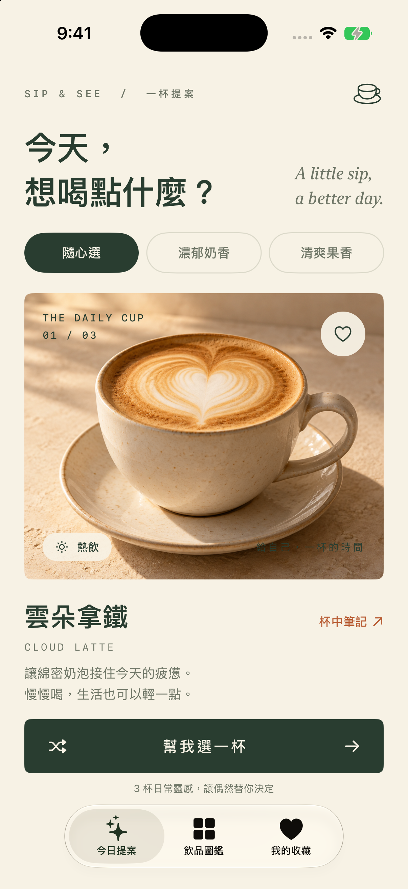
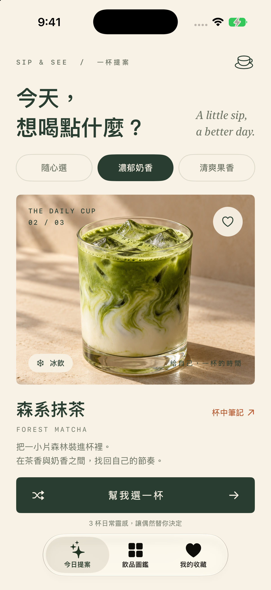
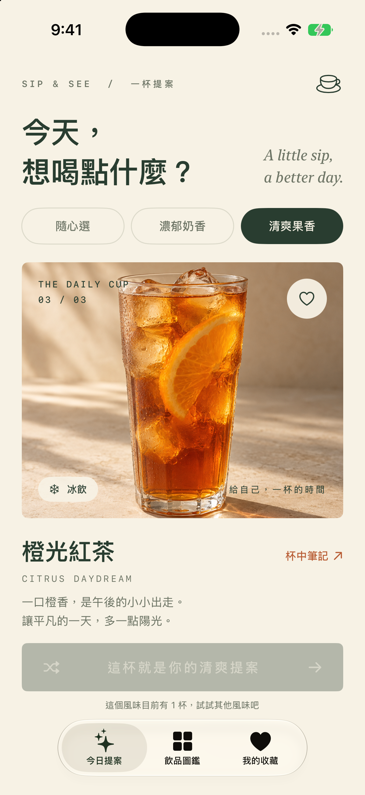
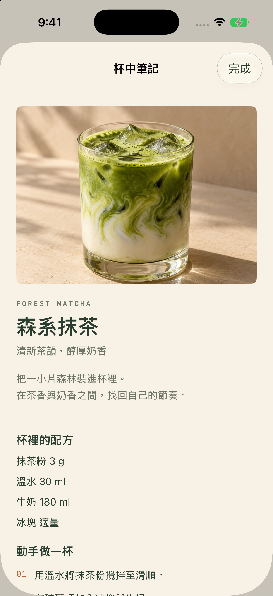
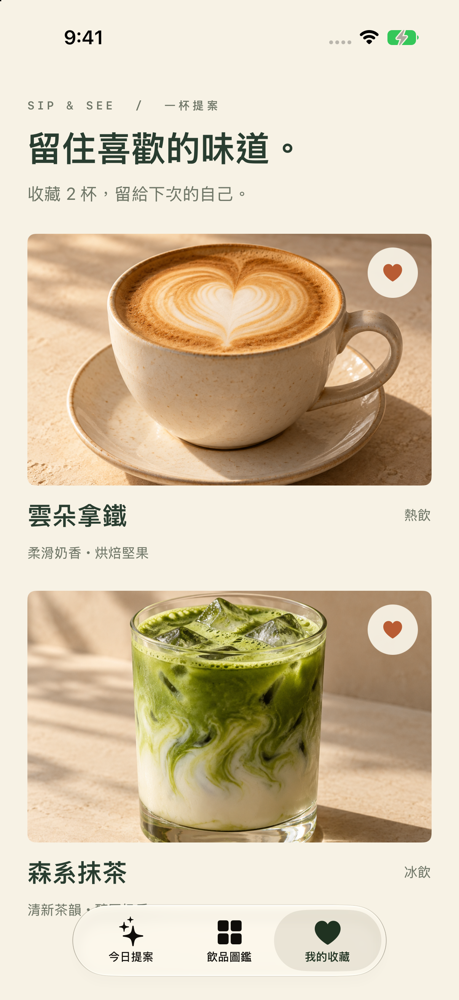

# SwiftUI 作業 #225｜一杯提案 Sip & See：把選擇困難交給一個 Button

每天走進咖啡廳，最難的有時候不是找座位，而是決定今天要喝什麼。這次練習結合圖片、文字與 Button，我選擇做一個小小的飲品靈感 App——「一杯提案 Sip & See」。

打開 App，按下「幫我選一杯」，就會出現一款飲品。圖片、名稱、英文名字、冷熱標籤與介紹文字都會跟著改變。希望用一個簡單的互動，替日常增加一點偶然。

GitHub 原始碼：https://github.com/alanlu01/iOS_class_4

作業題目：[彼得潘 #225 結合圖片、文字、button 的 SwiftUI State 練習題](https://medium.com/彼得潘的試煉-勇者的-100-道-swift-ios-app-謎題/225-結合圖片-文字-button-的-swiftui-state-練習題-3cd0ca2b194d)

## 一、先幫 App 設定一種氣氛

我希望它像一本咖啡廳的小誌，所以使用米白底色、森林綠按鈕與暖色飲品圖片。首頁除了中文標題，也放了一句「A little sip, a better day.」，讓選飲料這件事多一點悠閒的感覺。

目前設計了三杯飲品：雲朵拿鐵、森系抹茶、橙光紅茶。三張飲品主圖使用 AI 生成，存進 Assets.xcassets，離線也能顯示。這些圖片是 App 的視覺素材；本文的 App 畫面則是在 iOS 模擬器實際執行後擷取。



## 二、用資料模型把圖片和文字綁在一起

如果把飲品名稱、圖片名稱與介紹分別放在不同陣列，很容易在切換時對錯位置。我把一杯飲品需要的資訊集中在 Drink 結構裡，讓每一筆資料代表一杯完整的飲品。

```swift
struct Drink: Identifiable, Equatable {
    let id: String
    let name: String
    let english: String
    let image: String
    let category: Flavor
    let temperature: String
    let note: String
    let description: String
    let ingredients: [String]
    let steps: [String]
}
```

例如雲朵拿鐵的 image 對應 Latte 這個 Image Set，name 是「雲朵拿鐵」，temperature 則是「熱飲」。切換整個 Drink，就能一起更新所有對應內容。

## 三、這次的核心：@State 與 Button

首頁使用 @State 保存目前選到的飲品、風味篩選與抽選次數。

```swift
@State private var flavor: Flavor = .all
@State private var current = Drink.menu[0]
@State private var drawCount = 0
```

畫面上的圖片和文字直接讀取 current：

```swift
Image(current.image)
    .resizable()
    .scaledToFill()

Text(current.name)
Text(current.english.uppercased())
Text(current.description)
```

按鈕負責修改狀態：

```swift
Button {
    withAnimation(.easeInOut(duration: 0.25)) {
        current = DrinkPicker.next(for: flavor, excluding: current.id)
        drawCount += 1
    }
} label: {
    Text("幫我選一杯")
}
```

這段是首頁按鈕的核心邏輯；實際介面另外加上圖示、排版與單一選項時的提示。按下 Button 後，current 改變，SwiftUI 就會依照新狀態更新相關畫面，不需要逐一替圖片或文字元件設定新內容。



## 四、隨機選取也要考慮邊界情況

如果完全使用 randomElement()，可能連續兩次選到相同飲品。雖然程式有執行，使用者卻會覺得按鈕沒有反應。

因此，我會先依風味篩選候選飲品，再排除目前這一杯，最後從剩下的選項中隨機選取。

```swift
static func next(for flavor: Flavor, excluding currentID: String) -> Drink {
    let candidates = candidates(for: flavor)
    let alternatives = candidates.filter { $0.id != currentID }
    return (alternatives.isEmpty ? candidates : alternatives)
        .randomElement() ?? Drink.menu[0]
}
```

首頁有「隨心選」、「濃郁奶香」與「清爽果香」三個選項。濃郁奶香包含拿鐵和抹茶，清爽果香目前只有橙光紅茶。

只有一杯符合條件時，App 會停用抽選按鈕，顯示「這杯就是你的清爽提案」，並提醒可以試試其他風味。這樣就不會讓使用者一直按，卻看不出任何改變。



## 五、加上圖鑑、配方與收藏

除了隨機提案，我也增加了「飲品圖鑑」與「我的收藏」。圖鑑可以瀏覽三款飲品，點擊照片就能開啟「杯中筆記」，查看材料與三個製作步驟。



點擊照片右上角的愛心，就能收藏或取消收藏。收藏資料使用 @AppStorage 儲存在裝置上，關閉 App 再打開也會保留。

```swift
@AppStorage("savedDrinks") private var savedDrinks = ""
```

因為目前只有三款固定飲品，我用逗號分隔的 id 字串保存收藏，再轉成 Set 來查詢與切換。若未來加入大量資料或自訂飲品，可以再改用 Codable 或資料庫。



## 六、這次練習的收穫

這次使用 Codex 協助開發 SwiftUI 介面、整理邏輯與驗證操作。從「按一下換圖片」開始，逐漸延伸成圖片、文字、篩選與收藏互相連動的小 App。

我覺得最值得練習的地方，是先想清楚哪些資料屬於狀態，再讓畫面根據狀態呈現。當 current 代表完整的一杯飲品，按鈕要做的事情就很單純：選出下一筆資料，交給 SwiftUI 更新畫面。

原來一個 Button，也可以是今天的小小提案。

GitHub：https://github.com/alanlu01/iOS_class_4
